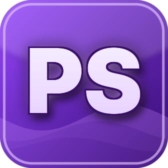

# PrettySmooth



Mod de **Geode** para Geometry Dash que otimiza o **jogo inteiro**: menu principal, fases e editor. Funciona no **PC (Windows / macOS)** e no **celular (Android)**.

Desenvolvedor: **LZ** · ID do mod: `lz.prettysmooth` · Geode **v5.11.2** · GD **2.2081**

---

## Presets

| Preset | O que faz |
|---|---|
| **Vanilla** | Jogo original, nada muda. |
| **Equilibrado** (padrão) | Partículas em 60%, transições rápidas, frame pacing, timer preciso e limpeza de memória. Quase sem perda visual. |
| **Desempenho** | Sem shaders, sem tremor, LDM forçado, partículas em 35%, prioridade alta. |
| **Batata** | Deixa o jogo **FEIO** de propósito: sem partículas, sem glow, sem fundo, sem middleground, sem rastros, texturas 16-bit, menu estático, transições instantâneas. |
| **UltraSmooth** | A potência máxima: tudo do Batata + FPS destravado (360), VSync off, frame pacing, prioridade alta, timer preciso, sem rastro da wave e editor turbo (visibilidade a cada 3 frames). |

Mexeu em qualquer opção manualmente? O preset vira **Personalizado**.

## Todas as opções

**Geral / FPS**
- Destravar FPS + FPS alvo (30 a 1000)
- Forçar VSync desligado *(só Windows)*
- Frame Pacing Suave (suaviza o delta time sem perder a sincronia da música)
- Prioridade alta (Windows: processo; Android: thread do jogo)
- Timer de alta precisão de 1 ms *(só Windows)*
- Contador de FPS roxo

**Fases**
- Partículas: Normal / Reduzidas / Desligadas + porcentagem
- Desligar shaders, tremor de câmera, glow
- Forçar Low Detail Mode (sem alterar a escolha salva na fase)
- Esconder fundo e middleground
- Desligar rastros (jogador/nave) e rastro da wave

**Menus**
- Partículas dos menus
- Menu principal estático
- Transições Normal / Rápidas / Instantâneas

**Editor**
- Partículas do editor, glow, prévia de shaders
- Desenhar grade (desligar deixa fases enormes muito mais leves)
- Atualização de visibilidade a cada N frames (fora do playtest)

**Sistema**
- Texturas 16-bit (metade da memória de vídeo, precisa reiniciar)
- Limpar memória ao sair de fases/editor
- Botão "Liberar memória agora"

## Menu roxo

Botão **PS** roxo:
- no **menu principal** (na fileira de baixo),
- na **pausa** das fases (canto inferior esquerdo),
- na **pausa do editor** (canto inferior direito).

O menu tem os presets em cima, abas (Geral, Fases, Menus, Editor, Sistema), botões ON/OFF, seletores e um "?" em cada opção que explica o que ela faz. O botão **Geode** abre a lista padrão de configurações do Geode.

---

## Arquivo `.geode` pronto

O [`release/lz.prettysmooth.geode`](release/lz.prettysmooth.geode) já vem compilado para **Windows (x64)** e **Android (64 e 32 bits)**. Para **macOS**, gere pelo GitHub Actions (Opção 1 abaixo).

## Como gerar o arquivo `.geode`

### Opção 1: GitHub Actions (sem instalar nada)
1. Crie um repositório **novo** no GitHub.
2. Envie todo o conteúdo desta pasta (inclusive a pasta `.github`).
3. Vá em **Actions** → **Build PrettySmooth** → espere terminar (ou clique em *Run workflow*).
4. Baixe o artefato **PrettySmooth**: dentro dele está o `lz.prettysmooth.geode` com Windows, macOS e Android (32 e 64 bits) juntos.

### Opção 2: no seu PC
1. Instale o [Geode CLI](https://docs.geode-sdk.org/getting-started/geode-cli) e rode:
   ```sh
   geode sdk install
   geode sdk update v5.11.2
   geode sdk install-binaries
   ```
2. Windows: Visual Studio 2022/2026 (com C++) ou LLVM/clang 19+. Android: Android NDK.
3. Dentro desta pasta:
   ```sh
   geode build                       # plataforma atual
   geode build -p android64          # Android 64 bits
   ```
4. O `.geode` aparece em `build/` (e já é copiado para a pasta de mods se o jogo for encontrado).

## Como instalar
- **PC:** coloque `lz.prettysmooth.geode` em `Geometry Dash/geode/mods/`.
- **Android:** com o Geode Launcher, copie o arquivo para a pasta `geode/mods/` do jogo (dá para abrir ela pelo próprio Geode, no ícone de pasta da lista de mods).
- Reinicie o jogo.

## Estrutura

```
mod.json              settings, presets e metadados
logo.png              ícone "PS" roxo (336x336)
resources/            sprite do botão PS
src/main.cpp          carga do mod e listener das settings
src/Config.*          config em cache + presets
src/hooks/Engine.cpp  FPS, VSync, frame pacing, prioridade, timer, memória
src/hooks/Particles.cpp
src/hooks/Gameplay.cpp  shaders, tremor, glow, LDM, fundo, rastros
src/hooks/Menus.cpp     menu estático, transições, botões PS
src/hooks/Editor.cpp    grade e visibilidade do editor
src/ui/               menu roxo, botões e contador de FPS
```
